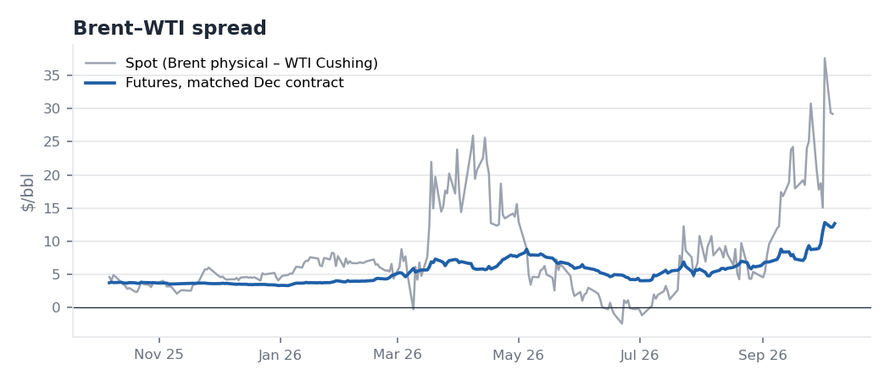
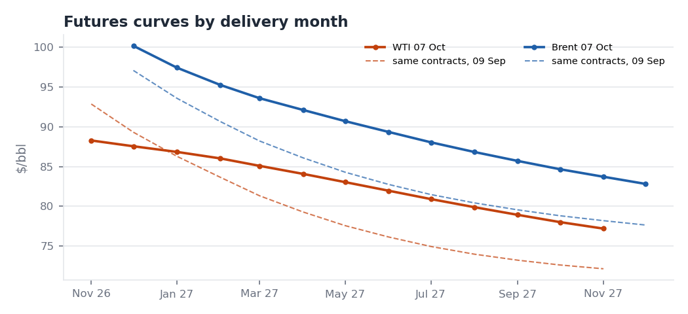
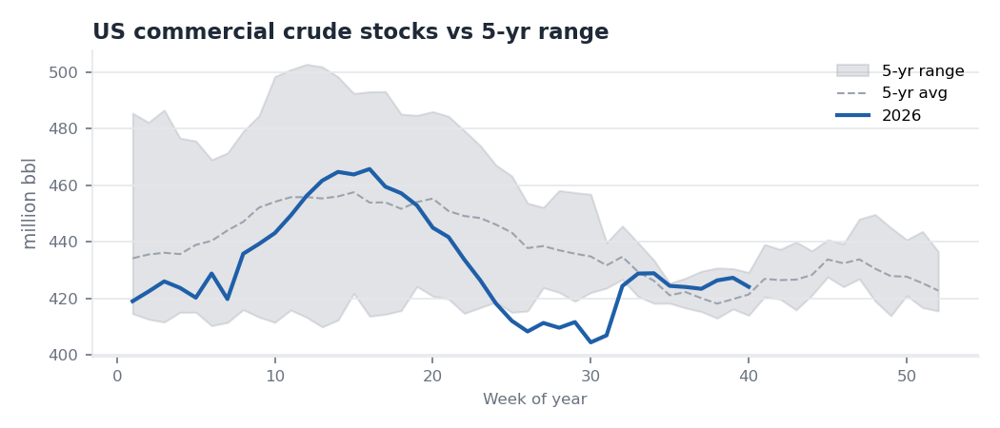

# Crude Oil Fundamental Monitor (Bilingual)

A weekly monitor of what is driving Brent and WTI. It combines a Python pipeline over EIA data, an Excel dashboard, a short statistical study, and English and Chinese market briefs.

**Question:** What is driving Brent and WTI right now, and what does it mean for the near-term balance and trading environment?
**Research question:** How do weekly US inventory, production and refinery developments interact with the Brent–WTI spread and crude curve structure?

## Weekly reports
One report per EIA release: as of the **Wednesday** NYMEX settlement (Thursday in federal-holiday weeks, when EIA publishes a day late). Each folder is self-contained: English brief, Chinese summary, Excel dashboard, charts, and data as of that date.

| Report | EIA week | Headline |
|---|---|---|
| [7 Oct 2026](reports/2026-10-07/brief_EN.md) · [中文](reports/2026-10-07/summary_CN.md) | to 2 Oct | Bullish crude draw (–3.2 mb vs +1.7 expected), yet WTI Nov–Dec fell to $0.73 as Cushing built a third week. Brent–WTI $12.65 |
| [30 Sep 2026](reports/2026-09-30/brief_EN.md) · [中文](reports/2026-09-30/summary_CN.md) | to 25 Sep | Crude bottleneck easing, products not: distillate 14% below the 5-year average, Nov ULSD crack $106 |

*The two reports above were reconstructed on 9 Oct 2026 under a strict as-of rule (only data and news public by each report's settlement). Reports from 14 Oct onward are written in real time.*

| | |
|---|---|
|  |  |
|  |  |

## Research findings (2010–2024, weekly; [details](output/analysis.md))
1. **Stock levels go with curve structure.** Deviations of Cushing and total US crude stocks from their seasonal norms explain 36% of the variation in the WTI M1–M2 spread. When Cushing was in its tightest quartile, the curve was backwardated 83% of the time; in its loosest quartile, 1% of the time.
2. **Weekly inventory changes explain under 3%** of weekly spread or price moves. These are actual changes, not surprises against consensus.
3. **No significant evidence** that Cushing changes matter more when Cushing is already tight.
4. **Brent–WTI is wider when Cushing is tight and US exports are high** (2016 onward).

All results are associations, not causal estimates.

## Run
```bash
pip install -r requirements.txt
python pipeline.py                              # download latest data -> output/ (working view)
python pipeline.py --offline --asof 2026-10-07  # weekly report build -> reports/2026-10-07/
python analysis.py                              # statistics -> output/analysis.md
```
If `EIA_API_KEY` is set, EIA data come from the Open Data API v2; otherwise from EIA's public .xls files. Free key: https://www.eia.gov/opendata/register.php
```bash
export EIA_API_KEY="your-key"
```

## Outputs
| File | What |
|---|---|
| `reports/<date>/` | Weekly report: `brief_EN.md`, `summary_CN.md` (rewritten, not translated), `monitor.xlsx`, `charts/`, as-of data CSVs |
| `monitor.xlsx` (in each report) | Dashboard sheet plus data sheets. The dashboard holds a market snapshot, an EIA weekly table vs the 5-year range, a bullish/bearish checklist and 8 charts. Data sheets: curve structure, prices/spreads, EIA weekly, OPEC, China, Event Log (filtered to what was public on the report date) |
| `output/` | Latest working build and `analysis.md` (regression and regime results) |
| `data/manual/` | OPEC, China and event-log tables, entered by hand with a source URL and an `available` (publication) date per row |
| `data/sources/` | Archived primary sources, e.g. EIA WPSR highlights and the EIA STEO PDF |

## Weekly routine (every Wednesday after the EIA release)
1. Run `pipeline.py` to download data, then archive EIA's highlights text in `data/sources/`.
2. Update `data/manual/*.csv` with new events, OPEC/IEA/China data and their publication dates.
3. Run `pipeline.py --offline --asof <Wednesday>` and write `brief_EN.md` and `summary_CN.md` in the new report folder.
4. Verify every figure against at least one independent source. Log conflicts, exclusions (anything published after the cut-off) and corrections to earlier reports.

## Data and method notes
- **Sources:**
  - EIA (US government, public domain): spot prices and the Weekly Petroleum Status Report.
  - Yahoo Finance: futures prices, used only to compute spreads, curve shape and volatility. Raw futures prices are not redistributed in this repo; run the pipeline to download them.
  - EIA stopped publishing NYMEX futures in April 2024.
- **As-of rule:** futures use the report-day settlement. EIA spot uses the previous day, since EIA posts spot with a lag. EIA weekly data are included only once released (week ending Friday + 5 days). Manual rows are filtered by publication date.
- **Seasonality:** each week is compared with the observation nearest the same calendar date in each of the 5 prior years. Checked against EIA's published "% vs five-year average" for crude, gasoline and distillate in both reports: all six match after rounding.
- **Curve conventions:** M1 is the nearest contract not expiring on the report date (expiry rules in `pipeline.py`). Weekly changes are on the same contracts, and Brent–WTI uses matched delivery months. Cracks use HO, RB and CL contracts for the same delivery month.
- **Signals** are a transparent rule-based checklist, not a model. The briefs explain when a headline reading misleads.
- **Futures data quality:** Yahoo's NYMEX Brent (BZ) contracts trade thinly beyond the front months, and their settlements can differ from ICE Brent by $1–2 on some days. Each week the front-month Brent settle is cross-checked against a second source, and deferred Brent spreads (for example Dec/Dec) are treated as indicative. Weekly price changes use the same contract to avoid roll distortion.
- **Every brief ends with a verification log:** each figure, its sources, and whether it was verified, conflicting, or rejected.
- **OPEC, China and event data:** some figures come from third-party summaries of the primary reports. Check them against the primary PDF before relying on a number.

Field definitions: [DATA_DICTIONARY.md](DATA_DICTIONARY.md)
