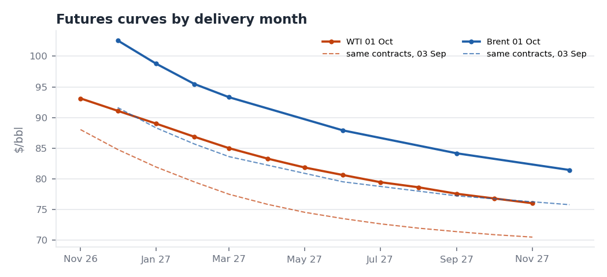
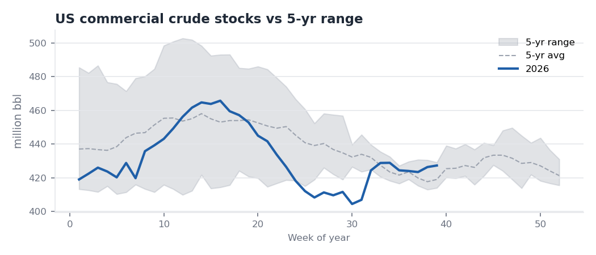
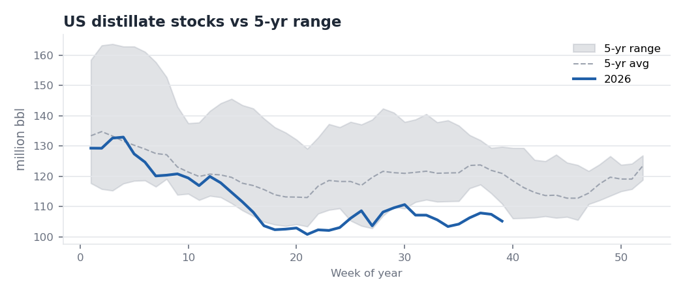

# Crude Oil Fundamental Monitor (Bilingual)

A weekly monitor of what is driving Brent and WTI. It combines a Python pipeline over EIA data, an Excel dashboard, a short statistical study, and English and Chinese market briefs.

**Question:** What is driving Brent and WTI right now, and what does it mean for the near-term balance and trading environment?
**Research question:** How do weekly US inventory, production and refinery developments interact with the Brent–WTI spread and crude curve structure?

## Latest read (week of 1 Oct 2026)
- **Main driver: the Gulf supply shock.** Physical Brent is about $12 over futures, and the Brent Dec26–Dec27 spread is above $20 (backwardation). The tightness is in prompt barrels.
- **WTI is lagging.** The matched-month Brent–WTI futures spread widened from $6.9 to $11.4 in a month. US crude stocks are 7.8 mb above their 5-year average, while US exports are flat.
- **The EIA crude build is less bearish than it looks.** It came from lower refinery runs. Gasoline and distillate are each about 16 mb below their 5-year averages.

Full briefs: [English](briefs/2026-10-01_weekly_brief_EN.md) · [中文摘要](briefs/2026-10-01_weekly_summary_CN.md)

| | |
|---|---|
|  |  |
|  |  |

## Research findings (2010–2024, weekly; [details](output/analysis.md))
1. **Stock levels go with curve structure.** Deviations of Cushing and total US crude stocks from their seasonal norms explain 36% of the variation in the WTI M1–M2 spread. When Cushing was in its tightest quartile, the curve was backwardated 83% of the time; in its loosest quartile, 1% of the time.
2. **Weekly inventory changes explain under 3%** of weekly spread or price moves. These are actual changes, not surprises against consensus.
3. **No significant evidence** that Cushing changes matter more when Cushing is already tight.
4. **Brent–WTI is wider when Cushing is tight and US exports are high** (2016 onward).

All results are associations, not causal estimates.

## Run
```bash
pip install -r requirements.txt
python pipeline.py          # download + rebuild everything (add --offline to reuse data/raw)
python analysis.py          # statistics -> output/analysis.md
```
If `EIA_API_KEY` is set, EIA data come from the Open Data API v2; otherwise from EIA's public .xls files. Free key: https://www.eia.gov/opendata/register.php
```bash
export EIA_API_KEY="your-key"
```

## Outputs
| File | What |
|---|---|
| `output/monitor.xlsx` | Dashboard sheet plus data sheets. The dashboard holds a market snapshot, an EIA weekly table vs the 5-year range, a bullish/bearish checklist and 8 charts. Data sheets: curve structure, prices/spreads, EIA weekly, OPEC, China, Event Log |
| `output/charts/` | 8 core charts + analysis scatter |
| `output/analysis.md` | Regression and regime results |
| `briefs/` | One-page English brief and half-page Chinese summary (rewritten, not translated) |
| `data/manual/` | OPEC, China and event-log tables, entered by hand with a source URL per row |

## Weekly routine
1. Wednesday, after the EIA release: run `pipeline.py`.
2. When OPEC MOMR, IEA OMR or China customs data come out, update `data/manual/*.csv`. Log market events in the event log.
3. Re-run `pipeline.py`, then write the briefs from the Dashboard.

## Data and method notes
- **Sources:**
  - EIA (US government, public domain): spot prices and the Weekly Petroleum Status Report.
  - Yahoo Finance: futures prices, used only to compute spreads, curve shape and volatility. Raw futures prices are not redistributed in this repo; run the pipeline to download them.
  - EIA stopped publishing NYMEX futures in April 2024.
- **Seasonality:** the 5-year range is the same calendar week over the 5 full prior years.
- **Signals** are a transparent rule-based checklist, not a model. The briefs explain when a headline reading misleads.
- **OPEC, China and event data:** some figures come from third-party summaries of the primary reports. Check them against the primary PDF before relying on a number.

Field definitions: [DATA_DICTIONARY.md](DATA_DICTIONARY.md)
