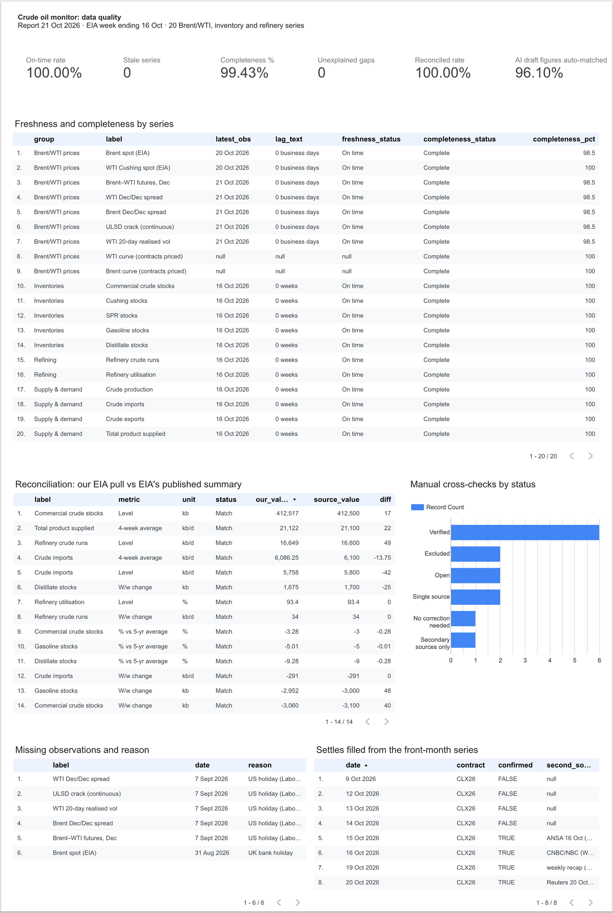
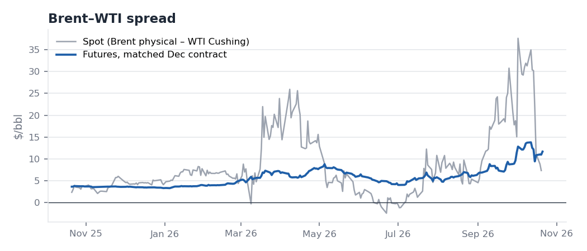
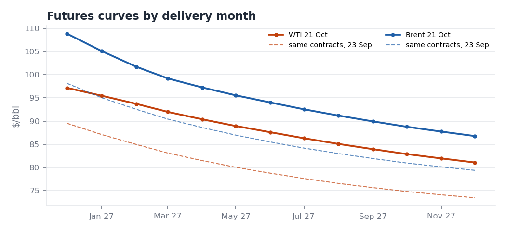
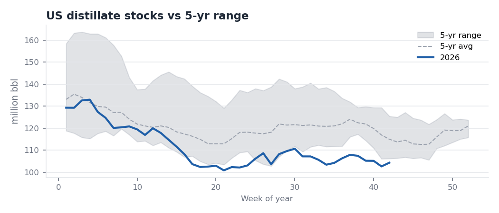

# Crude Oil Fundamental Monitor (Bilingual)

A weekly monitor of what is driving Brent and WTI. It combines a Python pipeline over EIA data, an Excel dashboard, a short statistical study, and English and Chinese market briefs.

**Question:** What is driving Brent and WTI right now, and what does it mean for the near-term balance and trading environment?
**Research question:** How do weekly US inventory, production and refinery developments interact with the Brent–WTI spread and crude curve structure?

## Data-quality dashboard
[Open the report in Data Studio](https://datastudio.google.com/reporting/edae83bb-c2f7-4b39-b0dd-2abd2fe13a3d) (view-only) · tables from `bi_export.py` · [definitions and build guide](bi/README.md)

For one report build, it checks whether each of the 20 Brent/WTI, inventory and refinery series was **fresh** under the as-of rule, **complete** once market holidays are allowed for, and **reconciled** with EIA's own published summary. It also shows the brief's manual cross-checks and the settlements filled from a second series. Loaded: the 21 Oct 2026 report. The completeness check found a pipeline bug that had dropped the Dec/Dec spreads from two reports (see *Futures data quality* below).



## Weekly reports
One report per EIA release: as of the **Wednesday** NYMEX settlement (Thursday in federal-holiday weeks, when EIA publishes a day late). Each folder is self-contained: English brief, Chinese summary, Excel dashboard, charts, and data as of that date.

| Report | EIA week | Headline |
|---|---|---|
| [21 Oct 2026](reports/2026-10-21/brief_EN.md) · [中文](reports/2026-10-21/summary_CN.md) | to 16 Oct | Third straight crude draw (–3.1 mb), driven by lower output, while Cushing built a fifth week. Brent follows Hormuz, +$2.76 to $108.82; ULSD crack –$10.54 as diesel supply returns |
| [15 Oct 2026](reports/2026-10-15/brief_EN.md) · [中文](reports/2026-10-15/summary_CN.md) | to 9 Oct (released Thu) | Hurricane Isaias: crude –8.6 mb vs –0.3 expected. WTI Nov +$6.48 vs Brent +$1.64; matched Brent–WTI $9.42, down from a $13.79 peak |
| [7 Oct 2026](reports/2026-10-07/brief_EN.md) · [中文](reports/2026-10-07/summary_CN.md) | to 2 Oct | Bullish crude draw (–3.2 mb vs +1.7 expected), yet WTI Nov–Dec fell to $0.73 as Cushing built a third week. Brent–WTI $12.65 |
| [30 Sep 2026](reports/2026-09-30/brief_EN.md) · [中文](reports/2026-09-30/summary_CN.md) | to 25 Sep | Crude bottleneck easing, products not: distillate 14% below the 5-year average, Nov ULSD crack $106 |

*None of these reports was published in real time. The 30 Sep and 7 Oct reports were reconstructed on 9 Oct 2026, and the 15 and 21 Oct reports on 25 Oct 2026, under a strict as-of rule (only data and news public by each report's settlement). 30 Sep and 7 Oct were written by hand; 15 and 21 Oct were drafted with the Claude API and then checked and edited (see below).*

| | |
|---|---|
|  |  |
|  |  |

## Research findings (2010–2024, weekly; [details](output/analysis.md))
1. **Stock levels go with curve structure.** Deviations of Cushing and total US crude stocks from their seasonal norms explain 36% of the variation in the WTI M1–M2 spread. When Cushing was in its tightest quartile, the curve was backwardated 83% of the time; in its loosest quartile, 1% of the time.
2. **Weekly inventory changes explain under 3%** of weekly spread or price moves. These are actual changes, not surprises against consensus.
3. **No significant evidence** that Cushing changes matter more when Cushing is already tight.
4. **Brent–WTI is wider when Cushing is tight and US exports are high** (2016 onward).

All results are associations, not causal estimates.

## Run
```bash
pip install -r requirements.txt
python pipeline.py                              # download latest data -> output/ (working view)
python pipeline.py --offline --asof 2026-10-07  # weekly report build -> reports/2026-10-07/
python analysis.py                              # statistics -> output/analysis.md
python brief_llm.py draft <date> --dry-run      # drafting prompts only, no API call -> reports/<date>/draft/
python bi_export.py <date>                      # data-quality tables -> bi/
python make_pdf.py <date>                       # brief PDFs (needs pandoc and Google Chrome)
```
`<date>` is a report date that already has a folder from the `--offline --asof` build. Running `brief_llm.py draft` on an existing report overwrites its `draft/` records.
API keys are read from environment variables only; none is stored in the repo (`.env` is git-ignored).
- `EIA_API_KEY` (optional): if set, EIA data come from the Open Data API v2; otherwise from EIA's public .xls files. Free key: https://www.eia.gov/opendata/register.php
- `ANTHROPIC_API_KEY`: needed only for `brief_llm.py draft` without `--dry-run`.
```bash
export EIA_API_KEY="your-key"
export ANTHROPIC_API_KEY="your-key"
```

## Outputs
| File | What |
|---|---|
| `reports/<date>/` | Weekly report: `brief_EN.md`, `summary_CN.md` (rewritten, not translated) and PDF copies of both, `monitor.xlsx`, `charts/`, as-of data CSVs |
| `monitor.xlsx` (in each report) | Dashboard sheet plus data sheets. The dashboard holds a market snapshot, an EIA weekly table vs the 5-year range, a bullish/bearish checklist and 8 charts. Data sheets: curve structure, prices/spreads, EIA weekly, OPEC, China, Event Log (filtered to what was public on the report date) |
| `output/` | Latest working build and `analysis.md` (regression and regime results) |
| `bi/` | Data-quality tables behind the dashboard, one row set per report (definitions in `bi/README.md`) |
| `data/manual/` | OPEC, China and event-log tables, entered by hand with a source URL and an `available` (publication) date per row |
| `data/sources/` | Archived primary sources, e.g. EIA WPSR highlights and the EIA STEO PDF |

## Weekly routine (every Wednesday after the EIA release)
1. `python pipeline.py` to download data.
2. Add new rows to `data/manual/*.csv` (events, OPEC/IEA/China data), each with its publication date in `available`.
3. `python pipeline.py --offline --asof <Wednesday>` to build the report folder.
4. `python brief_llm.py draft <Wednesday>`: Claude classifies the week's events and drafts both briefs; a script then validates every figure (see below).
5. Review: read `reports/<date>/draft/validation.md`, fix flagged and untagged figures, edit the analysis, and save the final `brief_EN.md` and `summary_CN.md` in `reports/<date>/`.
6. `python brief_llm.py finalize <Wednesday> --reviewer <name>` records the review (lines changed from the AI draft), adds a review note to both briefs and regenerates their PDFs.
7. After any other edit to a brief, `python make_pdf.py <date>` rebuilds its PDFs (pandoc for Markdown to HTML, headless Chrome for the PDF). The Markdown files stay the source.

## AI-assisted drafting and validation (`brief_llm.py`)
- **Model:** Claude Opus 5.5 via the Anthropic Python SDK. Structured JSON outputs; server-side fallback if a request is declined. Two calls: event classification (low effort), then drafting (high effort). Cost and tokens are logged in `draft/run.json`.
- **Inputs are as-of:** a fact sheet of ~100 computed numbers (prices, spreads, cracks, EIA weekly data, 5-year comparisons), sources published on or before the report date (EIA highlights, event log, OPEC/IEA/China rows, the regression findings), and the previous week's brief. The model is told to use nothing else.
- **Every number carries a tag:** `{{F:fact_id}}` or `{{S:source_id}}`. The validator checks each tagged number against its fact (allowing rounding and mb → 萬桶 / kb/d conversions; a sign is checked when written) or against the numbers in its source. It also lists every untagged number for manual checking. Tested on planted errors: wrong values, wrong signs, wrong Chinese unit conversions, unknown IDs and untagged figures are all caught.
- **What it does not check:** direction words ("rose", "fell") and the reasoning itself. Those are what the human review is for.
- **Logs:** `reports/validation_log.csv` (figures checked, matched, flagged, untagged, cost per report) and `reports/review_log.csv` (reviewer, lines changed from the AI draft).
- **First live run (25 Oct 2026):** four drafts, 573 tagged figures, 553 matched on the first pass. The validator flagged the only wrong number (a rounding error); every other flag was a formatting case or a number written as a word, checked by hand. The review still found sentences where the number was right but the claim was not, for example "a draw 8.6 mb larger than expected" (it was 8.3 mb larger) and a crack "fall" measured from a one-day spike. Cost: $2.21 for four reports. Details are in each report's `draft/validation.md` and in the review section at the end of the 15 and 21 Oct briefs.
- The 30 Sep and 7 Oct briefs were written by hand before this module existed. AI drafts for those dates are kept in their `draft/` folders as a benchmark, with a comparison against the verified brief (`draft/comparison.md`).

## Data and method notes
- **Sources:**
  - EIA (US government, public domain): spot prices and the Weekly Petroleum Status Report.
  - Yahoo Finance: futures prices, used only to compute spreads, curve shape and volatility. Raw futures price series are not redistributed in this repo (`data/raw/` is git-ignored); run the pipeline to download them. The briefs, the Excel dashboards and `data/manual/futures_patch.csv` quote individual settlements.
  - EIA stopped publishing NYMEX futures in April 2024.
- **As-of rule:** futures use the report-day settlement. EIA spot uses the previous day, since EIA posts spot with a lag. EIA weekly data are included only once released (week ending Friday + 5 days). Manual rows are filtered by publication date.
- **Seasonality:** each week is compared with the observation nearest the same calendar date in each of the 5 prior years. Checked against EIA's published "% vs five-year average" for crude, gasoline and distillate in both reports: all six match after rounding.
- **Curve conventions:** M1 is the nearest contract not expiring on the report date (expiry rules in `pipeline.py`). Weekly changes are on the same contracts, and Brent–WTI uses matched delivery months. Cracks use HO, RB and CL contracts for the same delivery month.
- **Signals** are a transparent rule-based checklist, not a model. The briefs explain when a headline reading misleads.
- **Futures data quality:** Yahoo's NYMEX Brent (BZ) contracts trade thinly beyond the front months, and their settlements can differ from ICE Brent by $1–2 on some days. Each week the front-month Brent settle is cross-checked against a second source, and deferred Brent spreads (for example Dec/Dec) are treated as indicative. Weekly price changes use the same contract to avoid roll distortion. Yahoo stops serving a contract once it expires; settlements it no longer serves are filled from its front-month series and logged with a second source in `data/manual/futures_patch.csv` (WTI Nov26, 9–20 Oct 2026). A pipeline change on 9 Oct 2026 stopped requesting the next-year December contracts (CLZ27, BZZ27), so Dec/Dec spreads were missing from 9 Oct; fixed on 1 Nov 2026 and the 15 and 21 Oct report data rebuilt (their briefs changed only in the verification log).
- **Every brief ends with a verification log:** each figure, its sources, and whether it was verified, conflicting, or rejected.
- **OPEC, China and event data:** some figures come from third-party summaries of the primary reports. Check them against the primary PDF before relying on a number.

Field definitions: [DATA_DICTIONARY.md](DATA_DICTIONARY.md)
