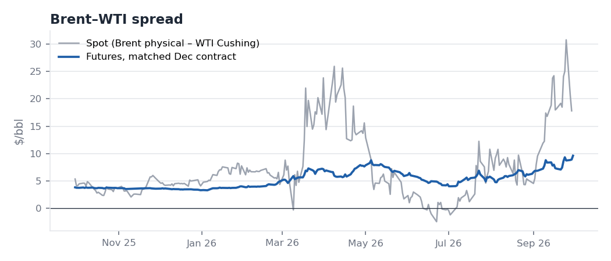

# Crude Oil Weekly — Wednesday 30 September 2026

*EIA WPSR week ending 25 Sep (released 30 Sep) · NYMEX settlements 30 Sep · EIA spot to 29 Sep*
*Reconstructed on 9 Oct 2026 using only data and news public by the 30 Sep settlement. Not published in real time.*

**Bottom line:** The crude bottleneck is easing, but products are not. Middle East crude exports are recovering and the US is building crude, with Cushing up 2.8 mb in two weeks. Meanwhile US distillate stocks are 14% below the 5-year average and the November ULSD crack is $106/bbl. **The balance favours Brent over WTI and products over crude.** WTI's prompt structure is softening. Flat price stays two-way and driven by headlines, around Iran and a possible US diesel export ban.

## 1. Market snapshot (Wednesday-to-Wednesday)

| | 30 Sep | w/w | Comment |
|---|---:|---:|---|
| Brent Nov26 (expired today) | $103.53 | +0.45 | Expired **$5.50 over Dec**, a sign of acute prompt tightness |
| Brent Dec26 (new front) | $98.03 | –0.09¹ | |
| WTI Nov26 | $90.42 | –1.74¹ | |
| Brent–WTI, matched Dec26 | $9.61 | +1.00 | $6.84 on 2 Sep; see §3 on headline vs matched spreads |
| WTI Nov–Dec | +$2.00 | –0.65 | Prompt WTI backwardation easing |
| Brent Dec–Jan | +$2.94 | –0.15 | |
| WTI Dec26–Dec27 | +$12.98 | –3.05 | |
| Brent Dec26–Dec27 | +$16.78 | –1.95 | Indicative: thin deferred contract |
| ULSD crack, Nov26 matched | $106.48 | +4.03 | The tightest part of the barrel |
| RBOB crack, Nov26 matched | $46.52 | –1.62 | |
| 3-2-1 crack, Nov26 matched | $66.51 | +0.27 | |
| EIA Brent spot (29 Sep) | $113.96 | –0.93 | ~$11.4 over Brent Nov futures |
| WTI 20-day realised vol | 45% | –0.5 pp | |

¹ The 23 Sep reference prices for Brent Dec and WTI Nov come from Yahoo only. The 30 Sep settles are confirmed by two sources.

## 2. Key fundamental developments

**Crude supply is recovering, product supply is not.**
- **Middle East exports:** Kpler (via Reuters, 28 Sep) puts September exports at **12.8 mb/d**, against roughly 17 mb/d before the war. Saudi exports are about **5.4 mb/d**, helped by ship-to-ship transfers off Oman after a pipeline outage.
- **Hormuz transits:** CNBC (30 Sep) reports crude flows through Hormuz back near pre-war levels, but fuel shipments still constrained.
- **Geopolitical risk:** the risk premium has not gone away. The US rejected Iran's offer on 26 Sep to reopen the strait within seven days, and Houthi missiles were fired at Saudi Arabia on 24 Sep (intercepted).

**US weekly data (week to 25 Sep):**
- **Crude stocks:** +0.9 mb to 427.3 mb, **2% above** the 5-year average, and +3.9 mb over two weeks.
- **Cushing:** +0.55 mb to 24.3 mb, +2.8 mb in two weeks, though still ~1.4 mb below its seasonal norm.
- **Refinery runs:** –554 kb/d to 16.3 mb/d (utilisation 92.5%), down 1.3 mb/d in three weeks. The crude build reflects lower runs during the maintenance season, not weak demand.
- **Products:** gasoline fell 1.7 mb (**7% below** average) and distillate fell 2.3 mb (**14% below**, under its 5-year range). **Total commercial inventories fell 7.0 mb.**
- **Demand:** 4-week product supplied was 20.8 mb/d (+2.1% y/y), with distillate demand +5.2% y/y and jet fuel +6.5% y/y.
- **Read:** the US is long crude and short products.

**US policy adds crude and puts product exports at risk.**
- **SPR:** DOE (29 Sep) is offering up to **40 mb** of SPR crude on exchange for Nov–Dec delivery from Bryan Mound and Big Hill. Those are Texas Gulf Coast sites, so the barrels land where US crude is already long. Take-up is uncertain: a similar offer in June placed only ~0.5 mb. The SPR is at 283.8 mb, its lowest since 1982.
- **Diesel exports — mixed signals:**
  - 22 Sep: the President backed keeping diesel at home.
  - 23 Sep: the White House denied Politico's report of a 90-day ban, and the Energy Secretary said a flat ban was not being considered.
  - 28 Sep: the President said a ban was being considered "very seriously".
  - A ban would cut Gulf Coast refinery runs and therefore US crude demand, which is bearish for WTI relative to Brent.

**OPEC+ and agencies.**
- **OPEC:** the September MOMR cut 2026 demand growth to **0.38 mb/d** (August: 0.60), its fifth straight cut, and raised 2027 growth to 2.36 mb/d. The call on DoC crude is 42.2 mb/d for 2026 and 43.9 mb/d for 2027.
- **IEA:** expects 2026 demand to **fall 2.5 mb/d**. The OPEC–IEA gap of ~2.9 mb/d is itself a source of uncertainty.
- **OPEC+:** the seven voluntary-cut producers meet on 4 Oct to set November targets. A rollover is expected because output is below quota.

**China.**
- **PMI:** the September official manufacturing PMI was **50.1**, back in expansion (August: 49.8).
- **August crude balance:** imports were 8.93 mb/d (–23% y/y) and runs 13.91 mb/d, a stock draw of 0.64 mb/d.
- **Fuel exports:** ~0.98 mb/d in August, expected above 1 mb/d in September. That eases Asian product tightness at the margin.

## 3. Analysis: the Brent–WTI spread and WTI structure

- **Headline vs matched spread.** Standard Chartered (30 Sep) quotes Brent–WTI at "over $12, widest since early May". Headline front-month quotes this week compare **Brent Nov at expiry with WTI Nov**, which builds in the $5.50 Brent Nov/Dec expiry squeeze. On **matched December contracts the spread is $9.61**: still widening (+$2.8 since 2 Sep), but the cleaner measure of relative value.
- **Why the arbitrage isn't closing.**
  - US crude exports averaged **3.77 mb/d in September**, below the pre-war Jan–Feb pace (~4.2) and far below Apr–May (~5.2), when a wide spread did pull barrels overseas.
  - Standard Chartered cites high VLCC freight, the market pricing in US refinery run cuts, and diesel export-restriction risk.
  - Our 2010–2024 study links a *wider* Brent–WTI with *higher* exports. Wide spreads combined with *low* exports point to a logistics constraint, not a normal pricing signal.
- **WTI structure.**
  - Our study finds Cushing's level relative to its seasonal norm is the strongest US-data correlate of WTI M1–M2 (2010–2024).
  - Cushing has built 2.8 mb in two weeks while Nov–Dec narrowed $0.65 and Dec/Dec narrowed $3.05. The direction is consistent with that relationship.
  - With SPR barrels due in Nov–Dec and Middle East crude recovering, the prompt WTI spread has **room to weaken further if Cushing keeps building**.

## 4. Trading implications

**Bullish**
- Product tightness: US distillate is below its 5-year range and total US commercial stocks fell 7 mb.
- Brent prompt premium: Nov expired $5.50 over Dec, and physical Brent is ~$11 over futures.
- Iran escalation risk: the US rejected the reopening offer and the Houthis fired at Saudi Arabia.

**Bearish**
- Middle East crude exports are rebounding and Saudi exports have doubled.
- US crude and Cushing are building, and 40 mb of SPR exchange crude is on offer.
- OPEC has cut its demand forecast five times in a row and the IEA expects 2026 demand to fall.

**Positioning view** (analytical, not a recommendation):
- **Relative value over outright.** The balance supports **Brent over WTI** (matched-month), **diesel cracks**, and **a softer WTI prompt structure**.
- **Main risk to the Brent–WTI view:** a clear White House decision against a diesel export ban could narrow the spread quickly (Standard Chartered).
- **Flat price:** two-way. Realised vol of 45% argues for small sizing.

## 5. Signposts for the week of 5 October

| Date | Event | What would change the view |
|---|---|---|
| Sun 4 Oct | OPEC+ meeting (November targets) | An unexpected increase would be bearish |
| Tue 6 Oct | EIA STEO; SPR exchange bids due | Change in EIA price path; SPR take-up |
| Wed 7 Oct | EIA WPSR (week to 2 Oct) | Third Cushing build? Exports responding to the spread? Runs recovering from maintenance? |
| Ongoing | US diesel export decision; US–Iran talks | A decided ban would widen Brent–WTI; ruling it out would narrow it |
| 1–7 Oct | China's National Day holiday | October product export approvals |

---

### Verification log

| Item | Value | Sources / check | Status |
|---|---|---|---|
| WPSR crude, products, runs, demand | as above | EIA official highlights (`data/sources/wpsr_summary_2026-09-30.txt`) vs our EIA API pull | Match |
| 5-year comparisons | crude +2%, gasoline –7%, distillate –14% | EIA % vs our same-date calculation (+1.8%, –6.8%, –13.7%) | Match after rounding |
| Brent Dec / WTI Nov 30 Sep settles | 98.03 / 90.42 | Yahoo, Investing.com, FinanceFeeds | Match |
| Brent Nov expiry 30 Sep | 103.53 | Yahoo; FinanceFeeds $103.50 | Match (±0.03) |
| 23 Sep Brent Dec / WTI Nov | 98.12 / 92.16 | Yahoo only | Single source |
| Matched cracks | HO, RB, CL Nov26 contracts | Computed; the continuous-contract crack ($117.8) mixed Oct HO with Nov CL and was rejected | Method corrected |
| Middle East exports 12.8 mb/d, Saudi 5.4 | | Kpler via Reuters (OilPrice, 28 Sep) | Single primary source |
| Hormuz crude flows near pre-war | | CNBC 30 Sep (headline; article blocked) | Secondary |
| Diesel ban timeline | 22, 23, 28 Sep | CNBC; Reuters via local outlets | Consistent |
| SPR 40 mb exchange | 29 Sep | OGJ; DOE bulletins | Consistent |
| OPEC Aug MOMR (0.6 / 2.2 / 42.1 / 43.6) | | OPEC primary PDF | Verified |
| OPEC Sep MOMR (0.38 / 2.36 / 42.2 / 43.9) | | Reuters (Investing.com), OilPrice; primary blocked | Secondary |
| China PMI 50.1 | | SCIO (official), FXStreet | Consistent |
| Excluded (after cut-off) | China fuel-export suspension (1 Oct), G7 release (2 Oct), EIA STEO (6 Oct) | Publication dates | Excluded |

Sources: [EIA WPSR](https://ir.eia.gov/wpsr/summary.txt) · [OilPrice/Reuters: ME exports](https://oilprice.com/Latest-Energy-News/World-News/Middle-East-Oil-Exports-Rebound-to-128-Million-Bpd.html) · [CNBC 30 Sep](https://www.cnbc.com/2026/09/30/iran-war-strait-hormuz-gulf-oil-fuel.html) · [Al Jazeera 28 Sep](https://www.aljazeera.com/economy/2026/9/28/oil-prices-surge-after-trump-rejects-irans-plan-to-reopen-strait-of-hormuz) · [The National 25 Sep](https://www.thenationalnews.com/business/energy/2026/09/25/oil-prices-waver-in-face-of-iran-war-truce-and-houthi-attacks/) · [CNBC 22 Sep](https://www.cnbc.com/2026/09/22/trump-diesel-export-ban-urkaine-russia-iran.html) · [White House denial 23 Sep](https://wmbdradio.com/2026/09/23/white-house-denies-report-us-is-considering-a-diesel-export-ban/) · [CNBC 28 Sep](https://www.cnbc.com/2026/09/28/diesel-oil-trump-export-ban-fuel-prices.html) · [OGJ: SPR exchange](https://www.ogj.com/general-interest/government/news/55408696/us-seeks-to-release-another-40-million-bbl-from-spr-despite-low-inventory-levels) · [Rigzone 30 Sep](https://www.rigzone.com/news/wti_discount_to_brent_deepens-30-sep-2026-184736-article/) · [FinanceFeeds: Brent expiry](https://financefeeds.com/brent-crude-price-november-expiry-roll/) · [Investing.com](https://www.investing.com/commodities/brent-oil-historical-data) · [OPEC MOMR Aug](https://www.opec.org/assets/assetdb/momr-august-2026.pdf) · [Reuters: OPEC Sep MOMR](https://www.investing.com/news/commodities-news/opec-further-lowers-2026-global-oil-demand-growth-forecast-4895797) · [IEA OMR Sep](https://www.iea.org/reports/oil-market-report-september-2026) · [AGBI: OPEC+](https://www.agbi.com/oil-and-gas/2026/09/opec-likely-to-keep-output-targets-steady-at-sunday-meeting/) · [SCIO: China PMI](http://english.scio.gov.cn/pressroom/2026-09/30/content_118718778.html) · [Hydrocarbon Processing: China Aug](https://www.hydrocarbonprocessing.com/news/2026/09/china-draws-on-crude-inventories-in-august-as-refinery-runs-rise/)
