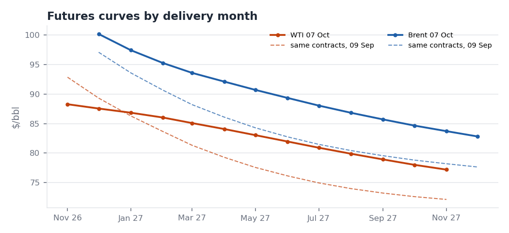

# Crude Oil Weekly — Wednesday 7 October 2026

*EIA WPSR week ending 2 Oct (released 7 Oct) · NYMEX settlements 7 Oct · EIA spot to 6 Oct*
*Reconstructed on 9 Oct 2026 using only data and news public by the 7 Oct settlement. Not published in real time.*

**Bottom line:** The US crude draw was bullish against consensus, but WTI's prompt structure almost flattened anyway.
- **Crude stocks** fell 3.2 mb, against a 1.7 mb build expected (Reuters poll).
- **WTI Nov–Dec** fell to **$0.73** (from $2.00) as Cushing built for a third straight week.
- **Brent–WTI (matched Dec)** widened **$3.04 to $12.65**, even after the President ruled out a diesel export ban on 2 Oct. Last week's read put too much weight on the export-ban factor.
- **The spread now reflects two different markets.** The Atlantic Basin physical market is extremely tight: EIA's Brent spot is ~$25 over Dec futures. The US mid-continent is loosening.
- **Diesel cracks have not fallen yet.** The G7/IEA stock releases, diesel first, have so far been offset by China's suspension of fuel exports.

## 1. Market snapshot (Wednesday-to-Wednesday)

| | 7 Oct | w/w | Comment |
|---|---:|---:|---|
| Brent Dec26 | $100.20 | +2.17 | Settle confirmed (Reuters) |
| WTI Nov26 | $88.28 | –2.14 | Settle confirmed (Reuters) |
| Brent–WTI, matched Dec26 | $12.65 | +3.04 | Just below the 2 Oct peak ($12.82), the widest since this pair began trading in our data (Oct 2024) |
| WTI Nov–Dec | +$0.73 | –1.27 | Was +$3.55 on 9 Sep; near contango |
| Brent Dec–Jan | +$2.75 | –0.19 | Brent prompt holding |
| WTI Dec26–Dec27 | +$11.13 | –1.85 | WTI curve flattening: front down, back up |
| Brent Dec26–Dec27 | +$17.39 | +0.61 | Indicative (thin deferred contract) |
| ULSD crack, Nov26 matched | $105.87 | –0.61 | Little change despite stock-release news |
| RBOB crack, Nov26 matched | $47.56 | +1.04 | |
| 3-2-1 crack, Nov26 matched | $67.00 | +0.49 | |
| EIA Brent spot (6 Oct) | $125.44 | +11.5 vs 29 Sep | **~$24.9 over Brent Dec futures**; 2 Oct print $135.51 |
| WTI 20-day realised vol | 45% | –0.2 pp | |

## 2. What changed since last week

| Last week's read | What happened | Assessment |
|---|---|---|
| Diesel export-ban risk was one of three drivers of Brent–WTI | Ruled out on 2 Oct; the spread then widened $3 | **Overweighted.** Freight, physical Brent tightness and Cushing builds matter more |
| WTI prompt structure has room to weaken if Cushing keeps building | Cushing +0.44 mb (third build); Nov–Dec –$1.27 | Confirmed |
| Products tighter than crude | ULSD crack ~unchanged at $106; distillate stocks flat, 12% below average | Confirmed; policy supply has not yet shown up in prices |

## 3. Key fundamental developments

**US weekly data (week to 2 Oct): an export-led draw while Cushing builds.**
- **Crude stocks:** **–3.2 mb to 424.1 mb** (1% above the 5-year average), against a **+1.7 mb** Reuters consensus: about 4.9 mb tighter than expected.
- **Exports** rose **1.2 mb/d to 4.77 mb/d**, the arbitrage starting to work. **Imports** also rose 1.1 mb/d, to 6.84 mb/d.
- **Runs** rose 223 kb/d to 16.5 mb/d (utilisation 92.7%).
- **Cushing** rose **+0.44 mb to 24.7 mb**: +3.3 mb in three weeks, still ~1.5 mb below its seasonal norm.
- **Products:** gasoline +0.4 mb (6% below average), distillate flat (12% below), total commercial –6.9 mb.
- **Demand:** 4-week product supplied was 21.1 mb/d (+0.7% y/y). Distillate demand slowed to **–1.6% y/y** (from +5.2% last week), a first sign of demand response to $6+ diesel. Jet fuel was +6.0% y/y.
- **SPR:** –0.8 mb to 283.0 mb.
- **Read:**
  - The draw happened on the coast, through exports; Cushing kept building. That is why a bullish headline came with weaker WTI spreads.
  - The direction matches our 2010–2024 finding: Cushing's level drives WTI M1–M2.
  - The **size** of the move (–$2.8 since 9 Sep for a +3.3 mb Cushing build) is far larger than the historical sensitivity (~$0.03/bbl per mb). The market is also pricing **incoming supply**: up to 40 mb of SPR exchange crude for Nov–Dec, and recovering Middle East exports.

**Supply and geopolitics.**
- **EIA STEO (6 Oct), from the primary report:**
  - Middle East crude shut-ins were **4.8 mb/d in September**, down from 5.8 in August and a peak of 10.9 in May.
  - EIA assumes flows stay constrained through Q4, with shut-ins of 4.5 mb/d.
  - It forecasts **Brent at $105/b in 4Q26** (**+$14** vs September), $96 for 2026 and $84 for 2027. EIA cites attacks on Saudi Arabia's East-West pipeline and "extreme tightness in diesel markets".
  - The inputs were locked on 1 Oct, so the forecast excludes the G7 release. Futures (~$100 Dec) sit **below** EIA's Q4 path.
- **Kpler (via Al Jazeera, 7 Oct):** Gulf flows excluding Iran exceeded **81% of pre-war** in September.
- **Iran:**
  - 4 Oct: the strait stays closed until the US accepts Iran's conditions (Ghalibaf).
  - 6 Oct: the IRGC claimed full control of the strait, and a tanker was hit, injuring 12 crew.
  - 7 Oct: the US set out its terms, including a "meaningful" cut in Iran's enrichment capacity (Vance).
  - No deal is in sight.
- **OPEC+ (4 Oct):** the seven voluntary-cut producers kept **November targets unchanged** (second pause) and meet again on 1 Nov. Quotas are not binding while output is below target.
- **US Gulf of Mexico storm:** a storm is forecast to become the season's first hurricane. The Gulf produced 2.05 mb/d in September; ESAI models ~11 mb of lost output. The effect on WTI is mixed: lost production is bullish, refinery shutdowns are bearish for crude demand.

**Products and policy.**
- **G7 (2 Oct):** up to **100 mb** over four months, with diesel front-loaded in the first 20 days.
- **IEA (7 Oct):** members agreed to **speed up** releases and give diesel priority. Completing earlier commitments could bring ~100 mb; analysts note this is not necessarily new volume. France is reportedly releasing 10 mb of diesel.
- **US:** on 2 Oct the President held off on a diesel export ban ("we were never going to do it"). The G7 also pledged to avoid export restrictions among its members.
- **China (1 Oct):** refiners suspended product exports beyond Hong Kong and Macau until further notice, and PetroChina cancelled most October gasoline and jet cargoes. This removes roughly 1 mb/d of Asian supply and offsets the G7 release. **Beijing's post-holiday decision is the key swing factor for cracks.**

## 4. Trading implications

**Bullish**
- The crude draw beat consensus by 4.9 mb, and total US commercial stocks fell 6.9 mb.
- Physical Brent is ~$25 over futures. EIA's Q4 path ($105) is above the futures curve.
- No progress on Hormuz, attacks on tankers continue, and a Gulf hurricane threatens.

**Bearish**
- Cushing has built for three weeks, and the WTI front spread is close to contango.
- Middle East crude is above 80% of pre-war levels. SPR barrels are offered for Nov–Dec.
- G7/IEA diesel releases are under way. US distillate demand has turned negative y/y.

**Positioning view** (analytical, not a recommendation):
- **WTI structure:** the prompt spread is the weakest part of the complex. A Nov–Dec move into contango is plausible if Cushing builds again. The storm is the main upside risk.
- **Brent–WTI ($12.65):** still supported by physical tightness. But exports are now responding (4.77 mb/d); if they **sustain above ~4.5 mb/d**, the arbitrage should cap further widening.
- **Diesel cracks:** two-way. The diesel-first releases (first 20 days, to ~22 Oct) work against them; China's export halt works for them. Beijing's decision decides the near term.
- **Flat price:** the curve sits below EIA's Q4 view. Event risk is high (vol 45%).

## 5. Signposts for the week of 12 October

| Date | Event | What would change the view |
|---|---|---|
| ~8 Oct | End of China's Golden Week | Resumed product exports would be bearish for cracks; continued suspension bullish |
| Next WPSR (check EIA schedule; Columbus Day may move it to Thursday) | EIA (week to 9 Oct) | Fourth Cushing build? Exports held above ~4.5 mb/d? Storm impact |
| Mid-Oct | OPEC MOMR, IEA OMR, China September trade data | Demand revisions; Chinese crude imports after the export halt |
| Ongoing | US–Iran talks; tanker attacks; Gulf of Mexico storm track; SPR exchange awards | |

---

### Verification log

| Item | Value | Sources / check | Status |
|---|---|---|---|
| WPSR crude, products, runs, demand | as above | EIA official highlights (`data/sources/wpsr_summary_2026-10-07.txt`) vs our EIA API pull | Match |
| 5-year comparisons | crude +1%, gasoline –6%, distillate –12% | EIA % vs ours (+0.6%, –6.4%, –12.3%) | Match after rounding |
| Consensus for crude | +1.7 mb (Reuters poll); +1.9 mb (Investing.com) | Two polls | Consistent |
| Brent Dec / WTI Nov 7 Oct settles | 100.20 / 88.28 | Yahoo; Reuters; Investing.com | Match |
| 30 Sep reference settles | 98.03 / 90.42 | See 30 Sep report | Match |
| EIA Brent spot 6 Oct | 125.44 | EIA API; EIA daily price page shows ~$126 on 7 Oct | Consistent |
| EIA STEO numbers | | EIA STEO PDF (`data/sources/steo_2026-10.pdf`) | Primary |
| Kpler Gulf flows >81% | | Al Jazeera 7 Oct | Secondary |
| OPEC+ November rollover | | CNBC, The National, Enerdata, World Oil | Consistent |
| G7 / IEA / diesel ban / China halt | | The National; Reuters (Euronext); Fortune and Bloomberg; Reuters (MarketScreener) | Consistent |
| Storm | 2.05 mb/d GoM; ESAI ~11.2 mb | Reuters via Euronext | Single source |
| **Correction to the 30 Sep report** | none needed | — | — |
| **Excluded (after cut-off)** | China resuming October exports (Reuters 8–9 Oct); the President's pledge of no strikes before the midterms (8 Oct); new US sanctions (8 Oct) | Publication dates | Excluded |

Sources: [EIA WPSR](https://ir.eia.gov/wpsr/summary.txt) · [EIA STEO Oct](https://www.eia.gov/outlooks/steo/pdf/steo_full.pdf) · [Reuters via Euronext: 7 Oct settle, IEA, storm](https://live.euronext.com/en/financial-news/oil-prices-settle-down-iea-agrees-accelerate-oil-stock-release) · [Investing.com: EIA consensus](https://www.investing.com/economic-calendar/eia-crude-oil-inventories-75) · [CNBC: OPEC+ 4 Oct](https://www.cnbc.com/2026/10/04/opec-agrees-to-keep-november-oil-output-targets-steady.html) · [The National: OPEC+](https://www.thenationalnews.com/business/energy/2026/10/04/opec-keeps-oil-output-targets-unchanged-for-november/) · [Al Jazeera 4 Oct](https://www.aljazeera.com/news/2026/10/4/iran-says-strait-of-hormuz-to-remain-closed-until-us-meets-conditions) · [Al Jazeera 7 Oct](https://www.aljazeera.com/news/2026/10/7/us-sets-new-demands-for-iran-deal-what-are-they) · [The National: G7](https://www.thenationalnews.com/business/energy/2026/10/02/g7-members-agree-to-release-100-million-barrels-of-diesel-and-other-reserves/) · [Fortune: diesel ban](https://fortune.com/2026/10/03/us-diesel-export-ban-record-prices-trump-europe-g7-reserves-release/) · [Bloomberg: diesel ban](https://www.bloomberg.com/news/articles/2026-10-02/trump-says-us-to-hold-off-on-diesel-export-ban-after-g7-release) · [Reuters via MarketScreener: China](https://www.marketscreener.com/news/chinese-refiners-suspend-oct-fuel-exports-petrochina-cancels-cargoes-sources-say-ce785ad3dd8bf226) · [OGJ: SPR exchange](https://www.ogj.com/general-interest/government/news/55408696/us-seeks-to-release-another-40-million-bbl-from-spr-despite-low-inventory-levels)
